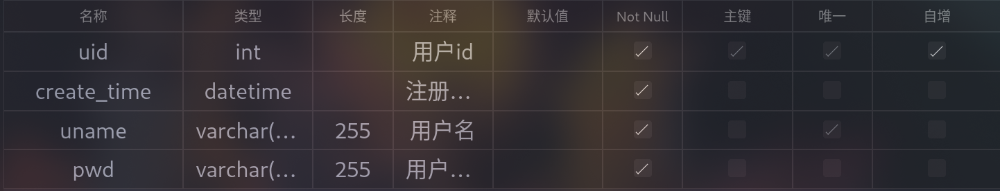

# Graduation-Project(毕业设计)

## 本地环境配置

### Mysql服务部署

- 使用docker命令：sudo docker run --restart=always -d --name mysql -p 3306:3306 -e MYSQL_ROOT_PASSWORD=123456 mysql:latest
- 用户名：root
- 密码：123456

#### Mysql基本配置

- - 建表命令：
    CREATE TABLE User(
    uid int NOT NULL PRIMARY KEY AUTO_INCREMENT COMMENT '用户id',
    create_time DATETIME COMMENT '注册时间',
    uname VARCHAR(255) UNIQUE COMMENT '用户名',
    pwd VARCHAR(255) COMMENT '用户密码'
    ) COMMENT '用户表';
- - 数据库名：shareNovel
- - 表：
- - - 用户表(User)：

### Redis服务部署

使用docker命令:sudo docker run --restart=always -p 6379:6379 --name myredis -d redis:latest --requirepass 123456

用户名：无

密码:123456

## api文档

- 基础路径:/api

- - 注册：
- - - 路径：/register
- - - 方法：post
- - - 参数：
- - - - uname:string 用户名
- - - - pwd:string 用户密码
- - - 返回值：json字符串
- - - - state 状态值（1为成功，0为失败）
- - - - message 说明信息
- - - - data token令牌/null

- - 登陆：
- - - 路径：/login
- - - 方法：post
- - - 参数：
- - - - uname:string 用户名
- - - - pwd:string 用户密码
- - - 返回值：json字符串
- - - - state 状态值（1为成功，0为失败）
- - - - message 说明信息
- - - - data token令牌/null

- - 修改密码
- - - 路径：/resetPwd
- - - 方法：post
- - - 参数：
- - - - newPwd:string 新密码
- - - - oldPwd:string 旧密码
- - - 返回值：json字符串
- - - - state 状态值（1为成功，0为失败）
- - - - message 说明信息
- - - - data token令牌/null

- - 注销功能
- - - 路径：/deleteUser
- - - 方法：post
- - - 参数：
- - - - pwd:string 密码
- - - 返回值：json字符串
- - - - state 状态值（1为成功，0为失败）
- - - - message 说明信息
- - - - data token令牌/null

- - 管理员登陆
- - - 路径：/alogin
- - - 方法：post
- - - 参数：
- - - - aname:string 管理员名
- - - - pwd:string 管理员密码
- - - 返回值：json字符串
- - - - state 状态值（1为成功，0为失败）
- - - - message 说明信息
- - - - data 管理员名

- - 添加管理员
- - - 路径：/addAdmin
- - - 方法：post
- - - 参数：
- - - - admins:Admin[] 第一个admin为发起请求的管理员 第二个admin为添加的管理员
- - - 返回值：json字符串
- - - - state 状态值（1为成功，0为失败）
- - - - message 说明信息
- - - - data null

- - 删除管理员
- - - 路径：/delAdmin
- - - 方法：post
- - - 参数：
- - - - admins:Admin[] 第一个admin为发起请求的管理员 第二个admin为删除的管理员，单个admin必须包含aname,pwd字段
- - - 返回值：json字符串
- - - - state 状态值（1为成功，0为失败）
- - - - message 说明信息
- - - - data null

- - 管理员审核评论
- - - 路径：/auditComments
- - - 方法：post
- - - 参数：
- - - - admin:Admin 审核评论的管理员必须包含aname,pwd字段
- - - - comments:Comments 被审核的评论必须包含aid,state,其中state 0为正常，-1为封禁
- - - 返回值：json字符串
- - - - state 状态值（1为成功，0为失败）
- - - - message 说明信息
- - - - data null

- - 管理员审核小说
- - - 路径：/auditNovel
- - - 方法：post
- - - 参数：
- - - - admin:Admin 审核评论的管理员必须包含aname,pwd字段
- - - - novel:Novel 被审核的小说必须包含id，state,其中state -1审核不通过 1审核通过 3管理员核实违规下架处理
- - - 返回值：json字符串
- - - - state 状态值（1为成功，0为失败）
- - - - message 说明信息
- - - - data null

- - 管理员审核用户
- - - 路径：/auditUser
- - - 方法：post
- - - 参数：
- - - - admin:Admin 审核评论的管理员必须包含aname,pwd字段
- - - - user:User 被审核的用户必须包含uid，state,其中state 0是正常 1是封禁
- - - 返回值：json字符串
- - - - state 状态值（1为成功，0为失败）
- - - - message 说明信息
- - - - data null

- - 添加评论
- - - 路径：/addCom
- - - 方法：post
- - - 参数：
- - - - comments:Comments 必须包含content,nid
- - - 返回值：json字符串
- - - - state 状态值（1为成功，0为失败）
- - - - message 说明信息
- - - - data null

- - 删除评论
- - - 路径：/delCom
- - - 方法：post
- - - 参数：
- - - - comments:Comments 必须包含id
- - - 返回值：json字符串
- - - - state 状态值（1为成功，0为失败）
- - - - message 说明信息
- - - - data null

- - 评论点赞
- - - 路径：/addCommentsLike
- - - 方法：post
- - - 参数：
- - - - commentsLike:CommentsLike 必须包含cid
- - - 返回值：json字符串
- - - - state 状态值（1为成功，0为失败）
- - - - message 说明信息
- - - - data null

- - 评论取消点赞
- - - 路径：/delCommentsLike
- - - 方法：post
- - - 参数：
- - - - commentsLike:CommentsLike 必须包含cid
- - - 返回值：json字符串
- - - - state 状态值（1为成功，0为失败）
- - - - message 说明信息
- - - - data null
 
- - 小说添加标签
- - - 路径：/addLabel
- - - 方法：post
- - - 参数：
- - - - novelLabels:NovelLabel[] 单个novelLabel必须包含nid,lid
- - - 返回值：json字符串
- - - - state 状态值（1为成功，0为失败）
- - - - message 说明信息
- - - - data null

- - - 小说删除标签
- - - 路径：/delLabel
- - - 方法：post
- - - 参数：
- - - - novelLabels:NovelLabel[] 单个novelLabel必须包含nid,lid
- - - 返回值：json字符串
- - - - state 状态值（1为成功，0为失败）
- - - - message 说明信息
- - - - data null

- - 用户添加收藏
- - - 路径：/addCol
- - - 方法：post
- - - 参数：
- - - - novel:Novel 必须包含id
- - - 返回值：json字符串
- - - - state 状态值（1为成功，0为失败）
- - - - message 说明信息
- - - - data null

- - 用户取消收藏
- - - 路径：/delCol
- - - 方法：post
- - - 参数：
- - - - novel:Novel 必须包含id
- - - 返回值：json字符串
- - - - state 状态值（1为成功，0为失败）
- - - - message 说明信息
- - - - data null

- - 用户举报评论
- - - 路径：/reportComments
- - - 方法：post
- - - 参数：
- - - - comments:Comments 必须包含id
- - - 返回值：json字符串
- - - - state 状态值（1为成功，0为失败）
- - - - message 说明信息
- - - - data null

- - 用户添加小说
- - - 路径：/addNovel
- - - 方法：post
- - - 参数：
- - - - novel:Novel  必须包含title,content
- - - 返回值：json字符串
- - - - state 状态值（1为成功，0为失败）
- - - - message 说明信息
- - - - data null

- - 用户删除小说
- - - 路径：/delNovel
- - - 方法：post
- - - 参数：
- - - - novel:Novel  必须包含id
- - - 返回值：json字符串
- - - - state 状态值（1为成功，0为失败）
- - - - message 说明信息
- - - - data null

- - 用户举报小说
- - - 路径：/reportNovel
- - - 方法：post
- - - 参数：
- - - - novel:Novel  必须包含id
- - - 返回值：json字符串
- - - - state 状态值（1为成功，0为失败）
- - - - message 说明信息
- - - - data null

- - 获取首页小说信息
- - - 路径：/index
- - - 方法：get
- - - 参数：
- - - - current:number
- - - - size:number
- - - - condition:Condition 枚举类：time,hot
- - - - sort:Sort 枚举类：asc,desc
- - - 返回值：json字符串
- - - - state 状态值（1为成功，0为失败）
- - - - message 说明信息
- - - - data uname:string

- - 获取用户名
- - - 路径：/showUname
- - - 方法：get
- - - 参数：
- - - - id:number
- - - 返回值：json字符串
- - - - state 状态值（1为成功，0为失败）
- - - - message 说明信息
- - - - data uname:string